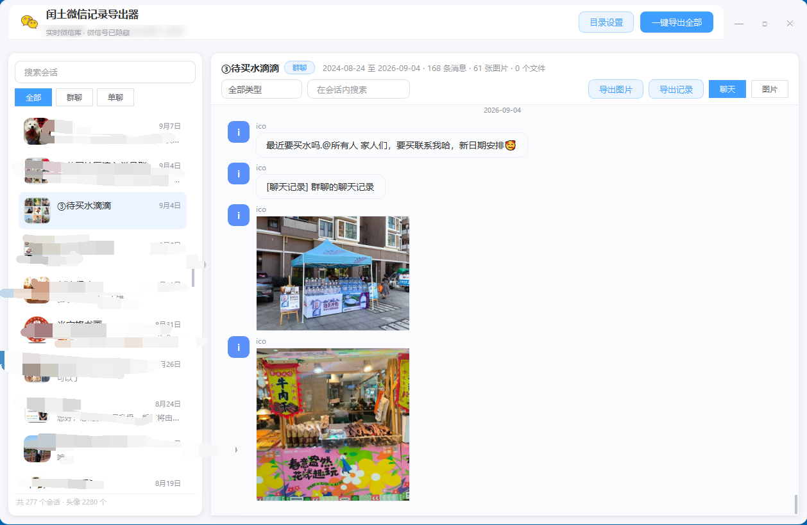
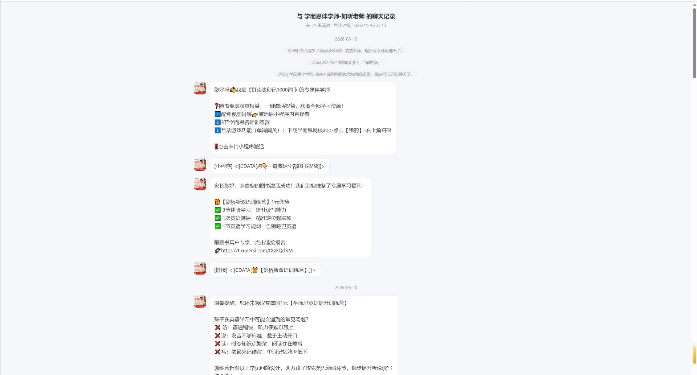

# 闰土微信记录导出器 · RuntuWx4Exporter

> 微信 4.x（Weixin 4.x）聊天记录的**本地查看与导出**桌面工具。
> 只读本机数据库，不联网、不上传；用于备份 / 迁移 / 留念**自己的**聊天数据。



---

## 功能

| 能力 | 说明 |
|---|---|
| 全部会话 | 直连微信库，一次列出本机所有会话（群聊 + 单聊） |
| 真实头像 | 从 `head_image.db` 取好友/群头像，列表与聊天气泡都显示 |
| 聊天预览 | 蓝/灰气泡、群聊显示发言人、日期分隔、加载更早消息、会话内搜索 |
| 类型筛选 | 文本 / 图片 / 文件 / 链接 / 语音 / 表情 / 视频 / 系统消息 |
| 图片墙 | 按日期排列的缩略图，双击看大图（← → 翻页、Esc 关闭、另存为） |
| 导出记录 | `txt` / `html` / `messages.json`；HTML 内嵌真实头像、图片、文件卡片 |
| 导出图片 | 支持时间范围；目录结构可选**按年月日分层**或**平铺** |
| 导出文件 | 文档/压缩包等，与图片同逻辑（文件名、`(1)` 后缀、大小三级匹配） |
| 一键导出全部 | 全部会话记录 + 可选图片/文件，打包 zip，可取消、可打开目录 |
| 启动目录选择 | 自动探测本机微信账号，记住后下次直进主页，也可随时切换 |
| 无边框圆角 | 自绘标题栏、阴影与圆角，设置/导出弹窗同样圆角 |

### 导出的 HTML 效果



> HTML 内嵌真实头像与图片，双击即可用浏览器查看，无需联网。

## 快速开始

```powershell
# 1. 独立虚拟环境（不污染系统 Python）
python -m venv .venv-pyside
.\.venv-pyside\Scripts\python -m pip install -r requirements.txt

# 2. 启动桌面版
.\.venv-pyside\Scripts\python -m wx4app
```

首次启动会要求选择微信账号目录（形如 `…\xwechat_files\wxid_xxx_1234`），
勾选「记住此目录」后下次直接进入。**需要微信已登录**（密钥从进程内存读取）。

> 只想看已导出的目录、不读微信库：`python -m wx4app --files-only`

## 打包为 exe

```powershell
.\scripts\build.ps1
# 产物：dist\闰土微信记录导出器.exe（约 80 MB，单文件）
```

手动打包命令见 [docs/BUILD.md](docs/BUILD.md)（注意 `--icon` / `--add-data` 必须绝对路径）。

## 项目结构（仅桌面版）

```
RuntuWx4Exporter/
├── run_wx4app.py          # 打包入口
├── wx4app/                # PySide6 桌面端
│   ├── window.py          #   主窗口：会话列表、聊天、图片墙、导出
│   ├── widgets.py         #   头像/气泡/聊天区/图片墙/灯箱（含 Delegate）
│   ├── frameless.py       #   无边框圆角窗口 + 自绘标题栏 + 阴影
│   ├── setup.py           #   启动前「连接微信数据」页
│   ├── export_dialog.py   #   导出选项（时间范围 / 内容 / 目录结构）
│   ├── theme.py           #   Element 风格 QSS
│   ├── config.py          #   目录配置（%LOCALAPPDATA%\wx4app\config.json）
│   └── assets/            #   logo / 勾选图标
├── wx4view/               # 数据层（桌面端共用）
│   ├── live.py            #   直连微信库：分页消息/图片/文件/导出/HTML
│   └── naming.py          #   纯函数：安全目录名/大小/文件名归一化（有单测）
├── wx4export/core.py      # 解码与图片工具（桌面端复用）
├── wxmanager/             # 微信 4.x 基础库
│   ├── wx4keys.py         #   密钥提取 + 数据库解密
│   └── wx4.py             #   账号目录 / 图片类型判定
├── tests/                 # pytest
├── docs/                  # 架构、构建、使用说明、截图
└── .claude/               # Claude Code 配置（命令 / 子代理 / 权限）
```

## 开发

```powershell
.\.venv-pyside\Scripts\python -m pip install -r requirements-dev.txt
.\scripts\lint.ps1          # ruff
.\scripts\test.ps1          # pytest
```

约定见 [CLAUDE.md](CLAUDE.md) 与 [CONTRIBUTING.md](CONTRIBUTING.md)。

## 性能

| 操作 | 优化前 | 现在 | 关键手段 |
|---|---|---|---|
| 会话列表刷新 | 2411 ms | **2~6 ms** | `QStyledItemDelegate` 只画可见行，条目只建一次 |
| 列表搜索 | 471 ms | **~5 ms** | 筛选只切可见性，不重建控件 |
| 点击会话 | 416 ms 阻塞 | **1~2 ms 响应** | 后台线程 + SQL 分页（只取当前页） |
| 会话内搜索 | 212 ms | **~40 ms** | 输入防抖 + 类级 QSS |
| 切换类型筛选 | 1545 ms | **5~40 ms** | `QImageReader` 按目标尺寸解码 + 缓存 |

首次打开几万条的大群约 0.5~1 秒（只解析当前页），期间显示「正在加载」，不阻塞界面。

## 数据与隐私

- **只读**微信数据库，不写任何文件到微信目录
- 密钥从微信进程内存提取，缓存 `%LOCALAPPDATA%\wx4export\keys.json`
- 图片/头像按需解密，缓存 `%LOCALAPPDATA%\wx4export\img\`
- 配置 `%LOCALAPPDATA%\wx4app\config.json`
- 全程本地运行，不联网、不上传

## 已知限制

- **语音**：微信 4.x 语音默认不落盘（库里只有 CDN 地址 + aeskey），
  本机 `msg/attach` 下无 `Audio/` 与 `.silk/.aud`，只能显示时长，无法播放。
- **本地缺失的图片/文件**：未在电脑端打开过的内容不会被缓存，导出时标记缺失。
- **部分头像**：`head_image.db` 无记录的联系人回退为首字彩色头像。
- 仅支持 Windows + 微信 4.x；微信未登录时无法取密钥（可降级浏览已导出目录）。
- 仓库只包含桌面版（exe）代码，网页版与命令行导出器不在本版本范围内。

## 免责声明

本项目仅用于导出**本人账号**的聊天数据，请遵守当地法律法规与微信服务协议。
因使用本工具产生的任何数据泄露或法律风险由使用者自行承担。

## License

[MIT](LICENSE) © 2026 runtu
