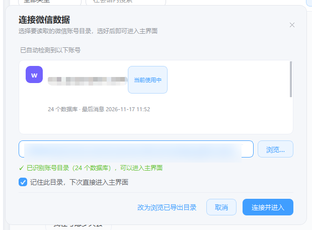

# 闰土微信记录导出器 · RuntuWx4Exporter

> 微信 4.x 聊天记录的**本地查看与导出**桌面工具（Windows）。
> 只读本机数据库，不联网、不上传；用于备份 / 迁移 / 留念**自己的**聊天数据。


---

## 能做什么

- 浏览本机全部会话（群聊 / 单聊），显示真实头像，支持按类型筛选与会话内搜索
- 导出聊天记录（`txt` / `html` / `json`）、图片、文件，支持时间范围与目录结构选择
- 一键导出全部会话并打包成 zip，可取消、完成后可直接打开目录
- 设置里可配置「工作目录」（导出默认位置）与「日志保留天数」，配置存于应用目录 `config.ini`

## 第一次用？跟着这 5 步走

> 前提：**微信 4.x 已登录并保持运行**（程序要从微信进程里取数据库密钥）。
> 系统要求：Windows 10 / 11（64 位）。

### 第 1 步：启动程序

双击 `闰土微信记录导出器.exe`。

首次启动会慢一点（10~40 秒），因为要从微信进程里提取密钥，属正常现象。
**不需要**安装 Python、不需要命令行。

### 第 2 步：连接微信数据（只需一次）

启动后会弹出这个窗口：



| 位置 | 怎么操作 |
|---|---|
| ① 账号列表 | 程序会自动检测本机微信账号。直接**点一下**要用的那个即可（「当前使用中」通常是日常在用的账号） |
| ② 路径框 | 也可以点「浏览…」自己选，支持三种层级：`…\xwechat_files`、`…\wxid_xxx_1234`，或直接选到 `db_storage` |
| ③ 校验提示 | 出现绿色的「✓ 已识别账号目录（N 个数据库），可以进入主界面」才算选对 |
| ④ 记住此目录 | **建议勾选**，下次启动就直接进主界面，不再询问 |
| ⑤ 连接并进入 | 点它进入主界面 |

> 如果列表是空的：说明微信没登录，或微信装在了非常规位置 → 点「浏览…」手动选到
> `C:\Users\你的用户名\Documents\xwechat_files\wxid_xxxxxxxx_xxxx`。

### 第 3 步：看聊天记录

进入主界面后：

1. **左侧**是会话列表，按最近聊天排序，可以搜索，也可以切「全部 / 群聊 / 单聊」
2. **点任意一个会话**，右侧就会显示聊天内容
3. 右上角可以在「**聊天 / 图片**」之间切换：
   - 聊天：蓝色气泡是自己、灰色是对方，群聊会显示发言人；顶部可「加载更早的消息」
   - 图片：按时间排列的缩略图，**双击看大图**（← → 翻页，Esc 关闭，可另存为）
4. 「全部类型」下拉可以只看图片 / 文件 / 链接 / 语音等；右边输入框可在会话内搜索

### 第 4 步：导出（核心功能）

点右上角的 **`导出记录`** / **`导出图片`**，或顶栏的 **`一键导出全部`**：

1. 弹出**导出选项**：
   - **时间范围**：全部 / 最近 7 天 / 30 天 / 3 个月 / 1 年 / 自定义起止日期
   - **导出内容**：聊天记录、图片、文件（可任意组合）
   - **聊天记录 HTML**：默认「按月拆分」，大会话也不会卡浏览器；取消勾选则生成单个大文件
   - **图片 / 文件目录结构**：按日期分层（`图片/2026/11/16/xxx.jpg`）或平铺到一个目录
2. 选**导出目录**（默认是你设置里的「工作空间」）
3. 底部出现**进度条**，可随时取消；此时界面照常可用
4. 完成后弹窗提示结果，点「**打开目录**」直接定位到导出位置

导出结果长这样：

```
<导出目录>/<会话名>/
├── 聊天记录.html          ← 双击用浏览器打开（按月拆分时是索引页）
├── 聊天记录.txt
├── messages.json          ← 给程序用的结构化数据
├── 聊天记录/2026-11.html   ← 按月拆分时的分页
├── 图片/2026/11/16/xxx.jpg
└── 文件/2026/11/16/xxx.pdf
```

### 第 5 步：按需调整设置

顶栏 **`设置`**：

- **工作目录**：导出的默认位置（默认在应用目录下的 `workspace`）
- **日志**：可开关、改目录、改保留天数（默认 30 天）、改级别；出问题时把日志发我可定位
- 保存后会在**应用目录**生成 `config.ini`，下次启动自动读取

---

## 界面导览

| 区域 | 作用 |
|---|---|
| 顶栏 | `连接微信数据`（换账号）、`设置`、`一键导出全部`、窗口控制 |
| 左侧列表 | 搜索、全部/群聊/单聊筛选、最近消息时间 |
| 右侧头部 | 会话名、群聊/单聊标签、时间范围、消息/图片/文件数量 |
| 右上工具条 | 类型筛选、会话内搜索、导出图片、导出记录、聊天/图片切换 |
| 底部 | 导出进度条（平时隐藏）、左上统计信息 |

## 常见问题

**Q：首次启动卡在「正在连接微信数据库…」？**
需要从微信进程内存取密钥，通常 10~40 秒。若超过 1 分钟：确认微信已登录、没被安全软件拦截；
仍失败就用「连接微信数据」手动选目录。

**Q：提示「没找到 db_storage」/ 列表为空？**
选到的是父目录而不是账号目录。要选到 `…\xwechat_files\wxid_xxxxxxxx_xxxx`
（里面有 `db_storage`、`msg` 两个文件夹）。

**Q：会话比手机上少？**
只显示**本地库里有消息**的会话；手机上删掉/未同步到电脑的不会出现。

**Q：头像显示成「首字方块」？**
该联系人在 `head_image.db` 里没有缓存头像（没加载过），属正常回退。

**Q：语音能听吗？**
不能。微信 4.x 的语音文件默认不落盘（库里只有 CDN 地址 + 密钥），所以只显示时长。

**Q：导出后 HTML 打开很卡？**
用默认的「按月拆分」；单个几十 MB 的页面浏览器渲染会吃力。图片多的话，
也可以只导出「聊天记录」不带图片。

**Q：导出的图片/文件少了？**
微信只缓存**电脑端打开过**的图片/文件，未下载过的会在结果里标为「本地缺失」。

**Q：换电脑 / 换微信账号？**
把新账号目录在「连接微信数据」里选一次即可；旧配置在应用目录 `config.ini` 里，
删掉它就能恢复默认。

## 数据与隐私

- **只读**微信数据库，不修改微信任何文件
- 密钥缓存在 `%LOCALAPPDATA%\wx4export\keys.json`
- 图片/头像缓存到 `%LOCALAPPDATA%\wx4export\img\`
- 配置在**应用目录** `config.ini`；日志默认在**应用目录** `logs\`
- 全程本地运行，**不联网、不上传**

## 从源码运行

```powershell
python -m venv .venv-pyside
.\.venv-pyside\Scripts\python -m pip install -r requirements.txt
.\.venv-pyside\Scripts\python -m wx4app
```

只看已导出的目录、不读微信库：`python -m wx4app --files-only`

## 打包为 exe

```powershell
.\scripts\build.ps1
# 产物：dist\闰土微信记录导出器.exe（约 80 MB，单文件）
```

手动打包命令见 [docs/BUILD.md](docs/BUILD.md)（注意 `--icon` / `--add-data` 必须用绝对路径）。

## 项目结构（仅桌面版）

```
RuntuWx4Exporter/
├── run_wx4app.py          # 打包入口
├── wx4app/                # PySide6 桌面端
│   ├── window.py          #   主窗口：会话列表、聊天、图片墙、导出
│   ├── widgets.py         #   头像/气泡/聊天区/图片墙/灯箱
│   ├── frameless.py       #   无边框圆角窗口
│   ├── setup.py           #   启动前「连接微信数据」页
│   ├── settings_dialog.py #   设置页（工作目录 / 日志）
│   ├── export_dialog.py   #   导出选项
│   ├── dialogs.py         #   圆角结果提示
│   ├── job_runner.py      #   独立进程导出（避免卡死/崩溃）
│   ├── config.py          #   config.ini 读写
│   ├── logging_setup.py   #   按天滚动日志
│   └── assets/            #   logo / 图标
├── wx4view/               # 数据层
│   ├── live.py            #   直连微信库：分页消息/图片/文件/导出/HTML
│   └── naming.py          #   纯函数（有单测）
├── wx4export/core.py      # 解码与图片工具
├── wxmanager/             # 微信密钥提取与数据库解密
├── tests/                 # pytest
├── docs/                  # 架构、构建、使用说明、截图
└── .claude/               # Claude Code 配置
```

## 开发

```powershell
.\.venv-pyside\Scripts\python -m pip install -r requirements-dev.txt
.\scripts\lint.ps1     # ruff
.\scripts\test.ps1     # pytest
```

约定见 [CLAUDE.md](CLAUDE.md) 与 [CONTRIBUTING.md](CONTRIBUTING.md)。

## 性能

| 操作 | 优化前 | 现在 |
|---|---|---|
| 会话列表刷新 | 2411 ms | **2~6 ms** |
| 点击会话 | 416 ms 阻塞 | **1~2 ms 响应** |
| 图片页切换 | 卡顿 | **同步 5 ms / 首屏 ~196 ms** |
| 导出 1.9 万条消息 | — | **约 2.5 秒** |

## 免责声明

本项目仅用于导出**本人账号**的聊天数据，请遵守当地法律法规与微信服务协议。
因使用本工具产生的任何数据泄露或法律风险由使用者自行承担。

## License

[MIT](LICENSE) © 2026 runtu
